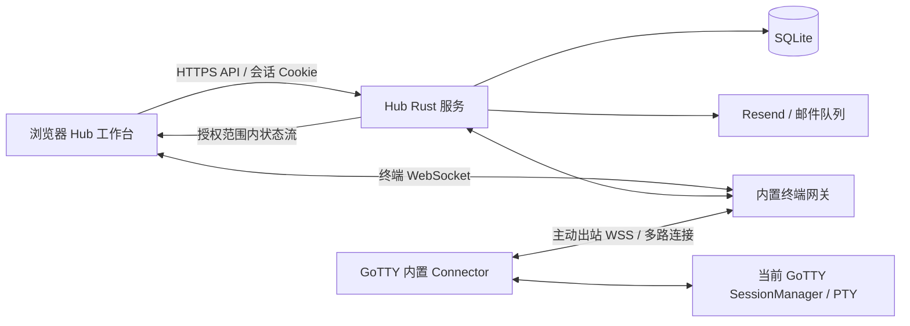

# GoTTY Hub 完整实施规划

日期：2026-11-09  
状态：已按用户后续授权实施，本文保留原规划基线。最终实现、技术取舍及验证边界见 [整体 Review](IMPLEMENTATION_REVIEW.md)、[ADR](ARCHITECTURE_DECISIONS.md) 和 [运维说明](OPERATIONS.md)。未执行生产部署或真实邮件投递。

本文整合历史 session `codex-session-01a1a09c-a828-7e53-9dd7-236a2e4d990c.md`、当前 Hub 原型及本轮 UI 决策。后续实施以本文为基线；与旧方案冲突时，以本文的明确取舍为准。

## 1. 产品目标与范围

GoTTY Hub 是面向 GoTTY 的自托管平台，内置终端穿透、邮箱认证、实例授权和多终端工作台。内网 GoTTY 主动连接 Hub，用户登录后直接在工作台访问有权限的实例，不需要自行部署或管理独立 http-tunnel 服务。

首版交付：单机部署、一个 Hub 绑定多个 GoTTY、一个 GoTTY 首版绑定一个 Hub；每实例连接当前已有共享 PTY。完整覆盖注册、验证、上线、访问、撤销、解绑、重连和升级。

不进入首版：任意 HTTP/TCP 代理、SSH 转发、多 PTY 创建、终端录像、团队组织、收藏、分组、实例总览首页、四分屏、多区域和集群高可用。现有 GoTTY 独立访问、分享能力继续可用，但不能成为绕过 Hub 授权的后门。

## 2. 已有能力与真实缺口

| 部分 | 已核对的现状 | 实施工作 |
|---|---|---|
| Hub 前端 | React、TypeScript、Vite、BoardUI 源码组件；双语、主题、标签、折叠、弹窗；静态演示终端 | 接入真实 API、认证及可复用终端组件，移除演示状态 |
| Hub 后端 | 当前目录没有 Hub Rust 服务、数据库和 Connector | 新建后端和部署骨架 |
| GoTTY 终端 | `js/src/webtty.tsx`、`xterm.tsx`、`websocket.ts`；支持输入输出、尺寸、回放等 | 提取无 UI 框架依赖的核心与适配接口 |
| GoTTY 服务端 | `server/session_manager.go`、`handlers.go` 有共享 PTY、回放、尺寸策略；分享可只读 | 增加经过认证的 Hub 接入适配，不能直接信任浏览器角色 |
| 原分享穿透 | `server/http_tunnel_client.go` 管理外部/内嵌 http-tunnel-client 进程 | 保留分享模式；Hub Connector 不依赖临时 share URL |
| http-tunnel | Rust 服务包含代理访问策略、路径过滤、WebSocket 代理等机制 | 评估传输复用和许可证，提取终端所需能力，不继承通用代理入口 |
| 状态图标 | GoTTY favicon 本地活动状态机及 `gotty-favicon` postMessage；Hub 有受来源校验的接收原型 | 统一绑定实例状态源；不能依靠 iframe 才能更新未打开实例 |
| 回归基线 | 当前 UI 已通过生产构建及 15 项浏览器测试 | 属于 UI 证据，不证明真实穿透、认证、移动输入已可用 |

历史方案中的 shadcn/ui 选型由当前 BoardUI 实现替代。保留当前组件、语义 token、React Aria、DirectionProvider；不重建第二套设计系统。

## 3. 最终页面与交互规格

### 3.1 页面外框

- 没有“我的实例”首页、搜索表格、收藏或分组入口；登录后直接进入终端工作台。
- 侧栏顶部是当前真实账号的名称/邮箱，底部不再重复账号信息。无显示名时使用邮箱；生产移除“演示账号”。
- 侧栏直接显示当前用户有权限的全部注册实例，包括离线实例；“全部”仅指获授权范围，不泄露平台其他实例。
- 在线项显示实例状态圆点，离线项显示独立断网 SVG。当前活动实例使用行背景色区分，选中动作不能直接改写颜色。
- 实例旁齿轮打开实例详情及授权管理；只读用户可查看允许的信息，管理控件按权限呈现。
- 顶部导航右侧保留语言、主题、账号设置齿轮；去掉“工作空间”和当前实例名。生产已登录时不再显示“登录”按钮或“原型预览”。
- 账号设置使用居中 Modal。实例详情保留 Drawer，手机实例选择使用左侧 Drawer。
- 接入实例“+”无论在侧栏还是标签行，均打开同一居中 Modal，不能改为侧抽屉或跳转首页。

### 3.2 工作区生命周期

登录完成后：优先恢复上次仍获授权的活动标签，否则打开第一个在线实例；无在线实例时保留侧栏和简洁空状态，不创建虚假终端。首次恢复工作区需要重新鉴权，不恢复旧访问票据。

点击在线实例打开或激活唯一标签，避免同一工作区重复建立同实例终端。切换标签保留连接、输出和滚动位置；关闭标签释放该连接和渲染资源，不停止远端 PTY。关闭最后一个标签后显示空状态；离线标签可以保留名称与离线图标，禁用输入并提供重连提示。

侧栏排序默认按名称稳定排序；在线/离线变化不自动移动正在操作的条目。用户不具备访问权限的实例从列表和标签移除，同时释放连接。

桌面首版双分屏，移动端单终端。分屏选取已打开的另一实例，没有候选时先选择实例，不自动创建额外 PTY。两个面板共享各自标签的终端控制器，不为同一实例复制 WebSocket。

### 3.3 折叠、最大化与尺寸

侧栏和导航栏独立折叠；恢复入口固定在标签行，标签横向滚动不会带走操作按钮。手机用抽屉代替固定侧栏。

工作区最大化隐藏侧栏、顶栏和说明页脚，让标签行与终端占满浏览器可用窗口；按钮和 Esc 可恢复进入最大化前的折叠状态。最大化是页内布局，不依赖浏览器 Fullscreen API。弹窗打开时 Esc 优先关闭弹窗，不能同时恢复工作区或向 PTY 发送 Escape。

侧栏折叠、导航折叠、分屏拖动、最大化、横竖屏和软键盘变化统一触发容器测量及 xterm fit。隐藏终端不向服务端上报 0×0，也不以后台标签尺寸争抢共享 PTY。

### 3.4 状态圆点协议：与 GoTTY 保持一致

| 颜色/图形 | 含义 | 精确色值 |
|---|---|---|
| 红圆点 | 正在查看 | `#de3c28` |
| 灰圆点 | 空闲 | `#9aa0a6` |
| 黄圆点 | 未查看期间有输出活动 | `#fbbc04` |
| 绿圆点 | 输出停止，待查看 | `#34a853` |
| 断网 SVG | 实例离线或连接不可用 | 独立图形，不能用灰点代替 |

黄色/绿色不等于命令运行/成功退出。活动停止阈值沿用现有默认 6 秒，离开查看的防抖默认 1 秒；参数纳入能力配置。状态 SVG 与算法进入共享模块，不能被主题重新着色。

**当前技术事实**：现有 favicon 依赖页面焦点与可见性，不同浏览器可计算出不同颜色；现有 postMessage 只有嵌入页面存在时才有消息，不能满足“全部在线实例显示一致状态”。因此必须升级状态来源，不能仅复制原型接收代码。

**绑定 Hub 后的目标**：由 GoTTY 实例维护唯一带版本的状态快照，Connector 经控制通道上传；Hub 将同一快照分发给全部获授权页面。GoTTY 直接页面、Hub 侧栏、Hub 标签消费同一快照，不分别重算。查看信息来自实际获得焦点且可见的终端视图，通过带过期时间的查看租约上报；多人同时查看时按任一有效查看租约判定红色，单纯选中侧栏不构成查看。设备负责去抖、活动和停止计时。未绑定 Hub 的 GoTTY 保留现有本地行为。

快照至少包含 `instance_id / connection_generation / revision / state / last_activity_at`。Hub 丢弃旧连接代次及旧 revision。设备重连后先同步完整快照再处理增量。未打开终端的实例也必须通过控制通道更新颜色，不额外创建 PTY 数据连接。

所有已连接实例必须有圆点：Hub 在设备上线握手时等待完整状态快照，快照到达前显示灰点并以提示说明“等待同步”，不能因此隐藏图标或改成问号；超过健康阈值进入连接异常提示，设备离线立即换断网 SVG。原型的默认灰色只是演示，不能当作真实活动状态。观看租约与多人聚合行为在阶段 0 用直接 GoTTY 页面和两个 Hub 浏览器共同验证并形成协议测试。

### 3.5 移动与无障碍

保持中英文完整覆盖，320/375/414/768px 无页面横向溢出；终端标签允许自身横向滚动。图标按钮有可访问名称、可见焦点和足够触控区域；不以颜色作为唯一信息来源。

真实验证 iPhone Safari、Android Chrome：中文组合输入、粘贴、快捷键、软键盘、旋转、后台恢复、安全区、动态地址栏。统一使用 viewport/fit 控制器，避免 CSS 与 JavaScript 双重补偿。弹窗关闭恢复焦点，不能误把管理操作输入发送给终端。

## 4. 架构与终端承载方式

Hub 一个部署单元包含静态前端、API、网关、邮件 worker、SQLite；优先 Rust/Tokio/Axum/SQLx。GoTTY 内置 Go Connector。共享协议使用独立版本，Go/Rust 不能各自凭约定实现而没有互通样例。

正式终端采用“Hub 外框 + GoTTY 终端核心”：Hub 集成 xterm、webtty、回放、编码、重连、文件和移动输入等现有能力。当前静态输出、装饰光标与不发送按键的快捷栏必须替换。

不直接穿透整个 GoTTY 管理网页，不从实例注入任意 JS 到 Hub。iframe 仅保留后续明确需要的旧版本兼容适配，不作为首版交付依赖；兼容路径未通过隔离/鉴权验收前不开放。原型 `gotty-favicon` 接收保留为适配素材，正式状态使用控制事件；若开启 iframe，必须校验 source、origin、实例绑定和消息白名单，禁用任意 SVG URL 注入。

Hub 使用自身构建的资源，终端协议数据经内置网关转发至当前 PTY。设备、用户、连接三个身份分别认证；不暴露任意目标 URL、端口或本地管理 API。

## 5. 共享代码与仓库落点

| 仓库/目录 | 计划职责 |
|---|---|
| `gotty/js/packages/terminal-core`（拟建） | 框架无关 TypeScript 核心、协议解析、回放、连接、状态算法、SVG、输入与 viewport 接口 |
| `gotty/js/src` | 独立 GoTTY 页面壳，消费同一核心；Preact/Bootstrap UI 不进入 Hub |
| `gotty/server/hub_*`（拟建） | 接入申请、设备持久化、Go Connector、当前会话适配、状态同步 |
| `gotty-hub/crates/hub-server`（拟建） | API、认证、授权、网关、持久化、邮件、事件与审计 |
| `gotty-hub/crates/hub-protocol`（拟建） | Rust 控制协议及序列化样例，与 Go 模型做契约互测 |
| `gotty-hub/frontend/src/features`（拟建） | auth、instances、workspace、settings；逐步拆分现有 `main.tsx` |
| `gotty-hub/frontend/src/terminal`（拟建） | React 适配器和权限化工具栏，不重新实现终端协议 |
| `gotty-hub/migrations`、`tests`、`deploy`（拟建） | 数据迁移、集成用例、Compose 与运维配置 |

核心默认以带版本和校验值的发布包消费，包名及发布位置阶段 0 确认。可通过内部 registry 或 release tarball 分发；不得依赖 `/data/projects` 相邻目录、绝对路径、未固定 Git HEAD 或手工拷贝两份实现。两个仓库干净检出后均能独立构建。发布核心时附许可证、依赖清单及协议支持范围。

## 6. GoTTY 注册与绑定

1. Hub “+”弹窗展示接入步骤和部署配置给出的真实 Hub 地址，不在浏览器直接创建任意穿透目标。
2. 用户在现有 GoTTY 管理页面选择“接入 Hub”，填写 Hub 地址、实例名称、所有者邮箱、初始授权邮箱与角色。
3. GoTTY 后端生成设备临时密钥和持久化中的申请，调用 Hub 申请接口；Hub 向所有者发送验证码。
4. 所有者在原 GoTTY 接入面板输入验证码；Hub 确认申请、设备持有证明与邮箱，原子创建实例、所有者授权和设备凭据。
5. GoTTY 持久化凭据，Connector 主动连接，协商协议/能力并同步状态；Hub 列表出现在线实例。
6. GoTTY 重启后沿用实例身份重连。绑定后的授权以 Hub 为准，不在每次重启重放初始邮箱清单。

申请与设备临时密钥绑定，限定次数、有效期和重试；确认幂等，过期申请不可重放。设备凭据不能作为用户终端访问票据。Hub 对申请接口、邮件和设备数量分别限流。

只有可验证的 GoTTY 管理身份能接入、换 Hub 或解绑。阶段 0 必须核对现有主页面与分享身份边界；本机未配置管理认证时，不得把“可访问网页”当管理员，应提供仅本机可取得的管理令牌/CLI 确认流程。

Hub 地址默认 HTTPS；允许明确配置的自托管内网地址，但必须禁止重定向到未验证目标和任意浏览器提交的本地目标代理。解绑先撤销设备凭据和用户连接，再清除本机绑定；离线解绑由 Hub 记录撤销，旧设备重连时拒绝。

## 7. 鉴权、权限与撤销

### 7.1 账号

邮箱验证码登录、邮箱密码登录、忘记密码及账号内改密。验证码一次性、短时有效且绑定用途；登录码不能用于设备绑定。密码仅存 Argon2id 哈希；不邮件发送明文。验证码和会话 token 仅存安全摘要，日志不记录。

浏览器使用 Secure、HttpOnly、SameSite Cookie；状态变更校验 CSRF 和精确 Origin。长期认证 token 不放 localStorage。邮箱规范化统一规则并保留显示形式，不擅自删除加号后缀或点号。公共认证接口不泄露账号是否存在。

生产中未登录显示认证 Modal/登录状态，不能展示演示邮箱、实例或虚假连接。邮箱/密码/设备鉴权各自限流，邮件 worker 支持去重、重试及到期作废；Resend 密钥仅在服务端配置。

### 7.2 权限矩阵

| 操作 | 所有者 | 操作者 | 观察者 |
|---|---|---|---|
| 查看状态、打开终端、接收输出 | 是 | 是 | 是 |
| 键盘输入、粘贴、语音转输入 | 本机允许时 | 本机允许时 | 否 |
| 上传/下载文件 | 能力及本机策略允许时 | 能力及本机策略允许时 | 首版均禁用 |
| 更改授权、轮换设备凭据、解绑 | 是 | 否 | 否 |
| 查看实例详情 | 完整 | 非敏感部分 | 非敏感部分 |
| 重启终端/执行管理 API | 首版 Hub 不暴露 | 否 | 否 |

有效权限 = Hub 角色 ∩ GoTTY 本机能力 ∩ 当前连接策略。前端禁用只是提示，Hub 网关和 GoTTY 连接适配都必须拒绝越权消息。观察者尺寸上报不能改变共享 PTY；明确复用既有 leader/fixed 等尺寸策略。

### 7.3 活跃连接撤销规则

- 授权移除/降级：立即更新授权版本，关闭或重建该用户在实例上的连接，重新取有效权限；清理列表和标签。
- 退出当前会话：关闭该会话所属终端连接和状态流；其他设备按各自会话继续。
- 改密/密码重置：撤销旧会话，当前设备经身份确认后建立替换会话；旧连接关闭。
- 实例解绑/设备凭据撤销：关闭对应设备控制通道与全部终端流，禁止旧凭据重连。
- 撤销传播目标不超过 2 秒；撤销提交后新增连接必须立即拒绝。网关失去权限控制状态时停止建立连接，不能无限沿用缓存。

## 8. API、事件与穿透协议草案

以下是拟定接口，阶段 0 输出 OpenAPI/消息 schema 后冻结 v1。路径可调整，权限与语义不能省略。

| 接口族 | 示例 | 要求 |
|---|---|---|
| 认证 | `/api/v1/auth/otp/request`、`otp/verify`、`password/login`、`password/reset`、`logout` | 用途绑定、限流、Cookie、CSRF |
| 当前账号 | `/api/v1/me`、`me/password`、`me/sessions` | 账号及会话管理 |
| 实例 | `/api/v1/instances`、`instances/{id}` | 按用户授权过滤，返回能力与状态快照 |
| 授权 | `/api/v1/instances/{id}/grants` | 所有者操作、并发版本校验、触发撤销 |
| 注册 | `/api/v1/enrollments`、`{id}/confirm` | 设备持有证明、幂等、限期 |
| 解绑/轮换 | `/api/v1/instances/{id}/binding`、`credentials/rotate` | 所有者认证，审计，关闭旧连接 |
| 访问票据 | `/api/v1/instances/{id}/terminal-tickets` | 绑定用户会话、实例、角色、授权版本；短时、一次性 |
| 终端 WS | `/api/v1/terminal-connections/{id}/ws` | 精确 Origin，握手先消费票据才转发 PTY |
| 状态 SSE | `/api/v1/events` | Cookie 鉴权、只发获授权元数据；断线后快照重同步 |
| 设备 WSS | `/connector/v1/connect` | 独立设备认证、协议协商、心跳与多路连接 |

浏览器 WebSocket 票据通过首个认证消息发送，升级前仍检查用户 Cookie 和 Origin；未认证连接限时、限量，不接触 PTY。禁止把长期凭据放进 URL。票据消费与授权版本检查原子执行。

设备控制消息最少包括 `hello/hello_ack`、心跳、能力快照、状态快照/增量、`open/open_ack/close`、撤销及错误。每条流有不可混淆的 stream_id、实例/设备绑定和授权上下文；二进制终端负载保留既有 webtty 语义。浏览器可提供尺寸和回放游标，不能声明角色或目标地址。

协议必须定义：消息长度、流数/队列上限、超时、背压、公平调度、关闭传播、未知消息处理、连接代次及版本不兼容错误。心跳建议 15 秒、连续 3 次超时离线，作为可配置初值；重连指数退避并加抖动。同实例重复设备连接按新代次替换旧连接，关闭旧流，审计原因。

能力协商包括读写、回放版本、尺寸策略、文件/语音等，不兼容时给可读错误，不盲目按最新协议解析。日志不得记录终端负载、访问票据或设备密钥。

## 9. 会话、恢复、文件与语音

一个 GoTTY 对应当前共享 PTY；Hub 标签不是新 shell。Hub 重启/隧道断开不能自动重启命令。Hub 不持久化终端输出，历史仍由 GoTTY 回放机制负责。

复用 `epoch + offset` 的回放边界；恢复时验证 epoch、buffer 范围和 replay begin/end，避免重复输出、丢字节或把旧会话误接到新 PTY。历史已淘汰时提示截断，PTY 已销毁时展示真实状态。生产 WebSocket 不能因切标签反复重连。

文件与语音需要受限功能通道，不能用通用 HTTP 代理补齐。ZMODEM 尽量复用现有终端通道；其他上传、ASR 的请求/返回单独定义白名单协议、容量、取消、超时和权限。现有取消传输不冻结终端的行为必须保留。ASR 默认不开启，依赖服务配置和能力协商；支持部署在 Hub HTTPS 域名后使用麦克风。生产不得显示“可用”按钮而实际无通道。

## 10. 持久化模型

| 数据实体 | 主要内容与约束 |
|---|---|
| User / PasswordCredential | 已验证邮箱唯一、账号状态、密码哈希版本 |
| UserSession / VerificationChallenge | token 摘要、用途、到期、尝试次数、撤销时间 |
| Instance / DeviceCredential | 稳定 ID、所有者、绑定状态、设备公钥或凭据摘要、代次 |
| InstanceGrant | 实例+规范化邮箱唯一、角色、授权版本；用户可尚未注册 |
| Enrollment | 临时设备公钥、申请摘要、验证码关联、期限、确认状态 |
| EmailOutbox | 幂等键、投递状态、次数、下次重试、到期 |
| AuditEvent | 主体、操作、实例、结果与关联 ID，不含终端内容 |
| UserPreference | 主题、语言、布局及可恢复标签；没有收藏/分组字段 |

活动连接、查看租约、心跳、状态订阅保存在内存；持久化 last_seen 仅用于展示，服务重启后实例先标离线，待认证重连后上线。数据库迁移采用版本化 SQL，外键/唯一约束、事务及授权并发更新必须验证。GoTTY 凭据文件最小权限 0600、目录 0700，原子写入并限制备份暴露。

## 11. 分阶段实施与完成门槛

每阶段拆成可单独评审的变更，完成验收再推进依赖阶段。以下为原始阶段门槛；当前实施状态与实测证据以整体 Review 为准。

| 阶段 | 交付任务 | 依赖/完成门槛 |
|---|---|---|
| P0 技术验证与协议定稿 | 审查许可证及传输边界；Go/Rust 互通；真实 xterm 往返；共享核心拆分试验；统一状态模型；管理身份边界 | 干净环境跑通一个内网 PTY 输入输出、断网恢复、只读拒绝和状态同步；提交 ADR、schema、兼容矩阵后才进入后续阶段 |
| P1 基础工程 | Rust 工作区、配置、SQLite/迁移、错误码、日志、开发邮件适配器、前端模块拆分、CI | 两仓库可独立构建；无演示凭据进入生产配置；单命令开发环境可启动 |
| P2 认证与授权底座 | OTP、密码、Cookie/CSRF、会话撤销、Resend outbox、权限服务和审计 | 正确/错误/过期/重放/限流用例通过；测试默认不发真实邮件 |
| P3 注册与在线状态 | GoTTY 接入面板、设备持有证明、凭据落盘、Connector、心跳、状态 SSE、轮换/解绑 | 注册→邮箱确认→在线闭环；重启身份稳定；分享用户不可绑定；全部获授权实例实时显示 |
| P4 真实终端纵向闭环 | 打开票据、网关流、共享核心 React 适配、输入输出/回放/尺寸、撤销关闭 | 至少两个实例、两个用户隔离；观察者伪造输入失败；断网重连无重复/串流；此阶段形成最小可用版本 |
| P5 原型交互落地 | 当前侧栏、账号标题、齿轮、Modal、多标签、独立折叠、最大化、双分屏、统一状态 | 原型交互全部连接真实数据；状态来源一致；关闭/切换资源释放正确；移除全部演示输出 |
| P6 附属能力与移动 | 文件、可选 ASR、快捷键、中文输入、viewport、后台恢复、能力降级 | 桌面及 iOS/Android 实机用例通过；取消上传/下载不冻结；权限全链路生效 |
| P7 发布与整体审查 | 压测、故障注入、安全 review、备份恢复、迁移、Docker/Compose、发布回滚 | 两仓库整体回归通过；修复阻断项；形成可复现发布记录和运维手册 |

建议评审拆分：协议/互通、共享终端核心、Hub 基础、认证、GoTTY 接入、网关、真实工作台、附属能力、运维。避免一个巨大变更同时改终端协议、鉴权和页面。文件/语音未完成时可以交付内部测试版本，不能把它当作本规划完整首版验收完成。

## 12. 验收与测试矩阵

| 范围 | 必测场景 | 通过标准 |
|---|---|---|
| 认证 | OTP 过期/复用、错误密码、账号枚举、CSRF、跨域 WS | 未验证用户拿不到实例/PTY；会话撤销真实生效 |
| 注册 | 重复确认、申请过期、伪造设备、分享访问者、离线解绑 | 不产生重复实例，旧凭据不可复用 |
| 角色 | 所有者/操作者/观察者、降级、移除授权、本机只读 | 改前端或伪造协议无法升级；撤销 ≤2秒 |
| 穿透 | GoTTY/Hub 重启、心跳超时、旧代次消息、慢消费、连接上限 | 不串实例；受控资源占用；恢复路径明确 |
| 状态 | 未开标签、两浏览器、直接 GoTTY 页面、焦点与活动停止、乱序、离线 | 同一快照在各入口一致；在线有点，离线为 SVG；背景独立于颜色 |
| 终端 | UTF-8/中文、粘贴、回放 epoch/offset、高速输出、多用户尺寸 | 无重复输出、输入串流或隐藏视图 0×0 覆盖 |
| UI | 没有首页/收藏/分组；两个“+”同 Modal；齿轮；折叠/最大化组合 | 恢复入口始终可达；Esc 只作用于正确层级；关闭全部标签不报错 |
| 附属能力 | 文件取消、大小限制、只读拒绝、ASR 禁用/失败 | 不冻结终端，不绕过角色，不传输未授权数据 |
| 移动 | 320/375/414/768px、iOS/Android 真机、旋转、后台、软键盘 | 无根页面横向溢出；焦点、中文与可视尺寸正确 |
| 运维 | 数据迁移、磁盘满、邮件故障、备份恢复、代理断流 | 失败可观测、凭据不泄漏、恢复有文档 |

测试层次：共享核心单元测试；Go/Rust 序列化和协议契约测试；真实 GoTTY+Hub 集成；Playwright 真实端到端；移动实机。保留 GoTTY 现有 Go、JS、ZMODEM、重连回放和分享回归。UI 演示测试逐步改为真实后端测试，不能只验证点击后改了页面 state。

压测暂定验证档位：50 个设备在线、每实例 2 个终端连接、10 个实例同时每秒输出 64KiB、持续 30 分钟；同时增加慢消费者和断线。它是验证目标而非已测容量。P0 固定测试硬件、内存预算及队列上限；P7 记录 CPU/内存、延迟与丢弃/断开原因，发现持续增长或跨实例阻塞则不能发布。

## 13. 部署、发布与回滚

提供 Hub Linux amd64/arm64 镜像、Compose、独立二进制；GoTTY 更新对应平台包。一个稳定 HTTPS 域名即可，终端按实例 ID 路由，不强制每实例子域名。反向代理明确配置 WebSocket upgrade、SSE 不缓冲、连接超时、上传限制和可信代理范围。

持久化 Hub SQLite、服务密钥和 GoTTY 设备身份；Resend/ASR 等密钥使用环境或 secret 文件，不提交仓库。备份使用 SQLite 一致性备份方法，不直接复制正在写入的单个数据库文件而忽略 WAL。

暴露健康/就绪检查及受保护的诊断信息：在线设备、活动流、拒绝/重连数、背压、outbox 积压。默认只记录授权和连接元数据，不记录终端输入输出。

升级先备份、检查协议支持范围、迁移数据库，再滚动重连设备；首版单节点 Hub 重启会断开 WS，客户端必须可重连。数据库采用向前兼容迁移，旧二进制不支持新 schema 时通过备份恢复回滚，不能盲目降级。协议不兼容时拒绝连接并提示升级，不自动创建不受限代理兜底。

发布前提交版本兼容矩阵、核心包锁定版本、数据库迁移说明、端到端记录及故障恢复步骤。公开发行与生产部署属于后续独立操作，本规划不执行。

## 14. 关键决策与实施前交付物

本规划固定：BoardUI；无首页直接工作台；共享 GoTTY 终端核心；Go Connector + Rust Hub；单实例当前 PTY；终端专用穿透；状态统一来源；邮箱授权；独立设备与用户身份。

P0 必须形成以下可评审结果，不能用“后续再考虑”跳过：

1. http-tunnel 可复用代码清单、许可证与 Go/Rust 传输互通结论；不可直接复用时提出受限传输实现 ADR。
2. 共享终端包 API、发布渠道、版本与两仓库独立构建验证。
3. v1 消息 schema、权限矩阵落实点、状态查看租约/断线时序、重连回放序列图。
4. GoTTY 管理身份与本地无认证部署的注册确认方案。
5. 默认超时、限流、内存/队列上限、文件大小和会话期限配置表。
6. 真实终端与手机输入技术验证记录；不能将当前静态原型当作通过证据。

在这些结果形成前，不启动大规模功能铺开。后续开工按 P0→P7 推进；实施结果另见整体 Review 文档。
